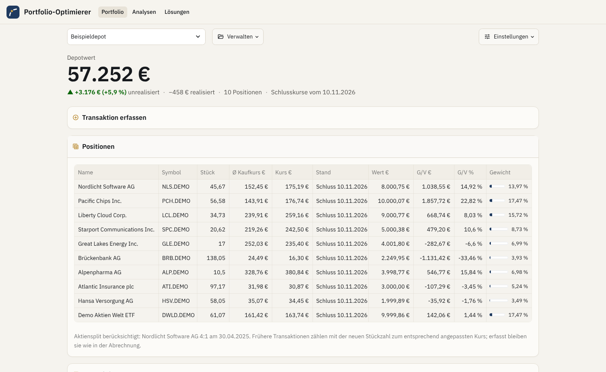
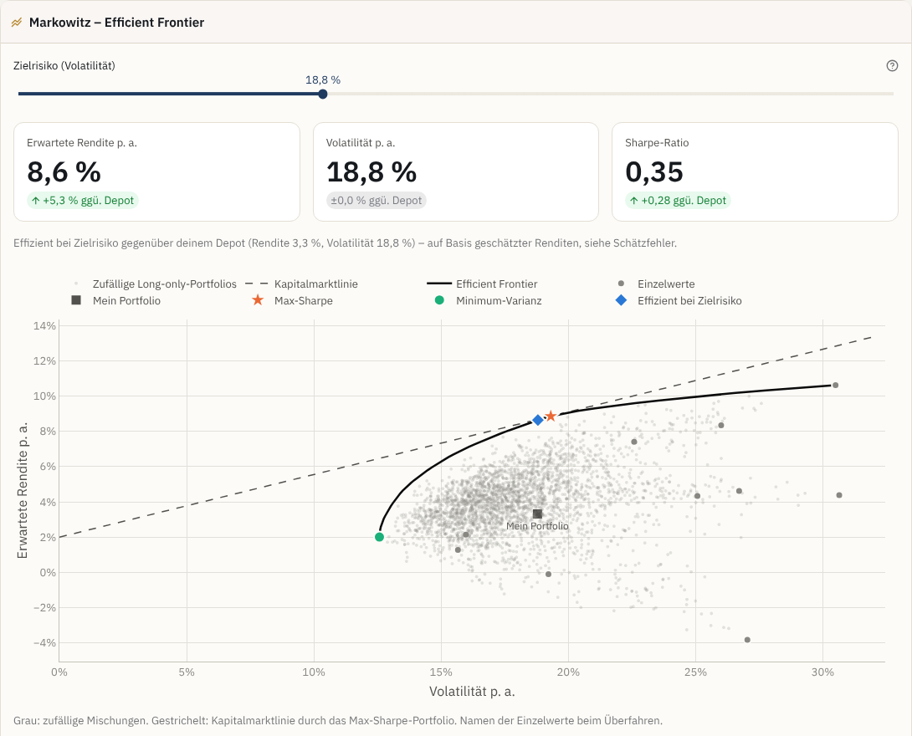
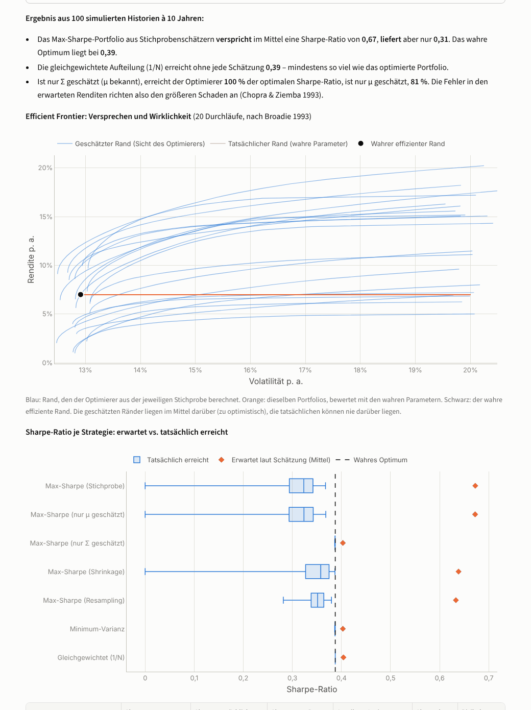

# Portfolio-Optimierer

Eine Streamlit-App für das eigene Depot: Käufe und Verkäufe mit Datum erfassen, die Wertentwicklung verfolgen, Klumpenrisiken erkennen, die **Efficient Frontier** nach Markowitz berechnen, die Vermögensentwicklung per **Monte-Carlo-Simulation** durchspielen und sehen, **warum die Optimierung mit geschätzten Parametern oft enttäuscht**. Zu jedem Befund schlägt die App Lösungen vor: Umschichtungen und Absicherungen.



## Aufbau

Die App hat drei Ebenen, die oben in der Leiste anklickbar sind. Jede Ebene besteht aus aufklappbaren Abschnitten; ein Abschnitt rechnet erst, wenn er geöffnet ist. Geöffnete Abschnitte und Eingaben bleiben beim Wechsel der Ebene erhalten.

| Ebene | Abschnitte |
|---|---|
| **Portfolio** | Transaktion erfassen · Positionen · Transaktionen · Wertentwicklung · Kursdaten und Kennzahlen · Aufteilung nach Sektoren und Währungen |
| **Analysen** | Klumpenrisiko · Markowitz – Efficient Frontier · Monte Carlo · Schätzfehler |
| **Lösungen** | Umschichtung · Absicherung |

Die Kopfzeile darüber gilt für alle Ebenen: Portfolio auswählen, **Verwalten** (Neu, Import/Export, Löschen, Papierkorb) und **Einstellungen**. Dort werden Marktdaten (Yahoo Finance oder Offline-Demo), die Länge der Historie für die Analysen, die Schätzer (historischer Mittelwert oder Bayes-Stein, Stichproben-Kovarianz oder Ledoit-Wolf), der risikolose Zins und die Gewichtsgrenzen (long-only, Höchstgewichte, Leerverkäufe oder klassischer unbeschränkter Markowitz) eingestellt.

## Schnellstart

```bash
python -m venv .venv
source .venv/bin/activate          # Windows: .venv\Scripts\activate
python -m pip install -r requirements.txt
python -m streamlit run app.py
```

Die App öffnet sich unter <http://localhost:8501>. Beenden mit `Strg + C` im Terminal. Nach einem Update der App die Pakete mit `python -m pip install -U -r requirements.txt` aktualisieren (die Oberfläche braucht Streamlit ab 1.66).

### Windows und VS Code

- **Starten:** `python app.py` oder der Start-Button von VS Code starten Streamlit automatisch. `python -m streamlit run app.py` funktioniert auch dann, wenn der Befehl `streamlit` allein nicht gefunden wird.
- **Interpreter wählen:** VS Code muss den Python-Interpreter verwenden, in den die Pakete installiert wurden: `Strg + Umschalt + P` → „Python: Interpreter auswählen“ → `.venv`.
- **Kurzer Pfad:** Windows begrenzt Dateipfade standardmäßig auf 260 Zeichen, und Streamlit enthält tief verschachtelte Dateien. Liegt das Projekt in einem langen Ordnerpfad (etwa tief in OneDrive), scheitert `pip install` in einer `.venv` im Projektordner. Abhilfe: das Projekt an einen kurzen Pfad außerhalb von OneDrive legen, z. B. `C:\Projekte\Portfolio-Optimierer`, oder [lange Pfade in Windows aktivieren](https://learn.microsoft.com/de-de/windows/win32/fileio/maximum-file-path-limitation).
- **`ModuleNotFoundError: No module named '…'`:** Im verwendeten Interpreter fehlen Pakete. Im Terminal von VS Code `python -m pip install -r requirements.txt` ausführen.

## Portfolio

**Marktdaten.** Unter **Einstellungen** stehen Yahoo Finance oder eine **Offline-Demo** mit fiktiven Wertpapieren zur Wahl. In der Demo lädt **Verwalten → Neu → Beispieldepot laden** ein Depot mit Käufen über drei Jahre, einem Teilverkauf und einem Aktiensplit 4:1. Yahoo-Daten kommen über [yfinance](https://github.com/ranaroussi/yfinance), eine inoffizielle Schnittstelle, für die die Nutzungsbedingungen von Yahoo gelten.

**Kurse.** Während der Handelszeit bewertet die App mit dem letzten Minutenkurs von Yahoo (in der Regel etwa 15 Minuten verzögert), sonst mit dem letzten Schlusskurs. Die Spalte „Stand“ der Positionstabelle zeigt, welcher Kurs gilt, etwa „live 14:32“ oder „Schluss 06.11.2026“. Bewertung, Wertentwicklung und der Kursvorschlag beim Erfassen beruhen auf den tatsächlichen Schlusskursen; Renditen und Risiken in den Analysen auf dividendenbereinigten Kursen. Alle Werte werden zum jeweiligen Tageskurs in Euro umgerechnet, auch Kurse in Pence (GBp). Warum Kurse zeitweise fehlen können und was die App dagegen tut, steht unter [Fehlende Kurse](#fehlende-kurse).

**Transaktionen.** Ein Wertpapier per Name, Ticker oder ISIN suchen oder aus dem Depot wählen, dann Kauf oder Verkauf mit Datum, Stückzahl und Kurs je Stück in Euro erfassen. Sobald Wertpapier oder Datum feststehen, trägt die App den Schlusskurs dieses Tages ein; gibt es keinen, bleibt das Feld leer. Für genaue Gewinne den Ausführungskurs aus der Abrechnung eintragen. Ein Verkauf kann den Bestand an seinem Datum nicht übersteigen. In der Tabelle **Transaktionen** lassen sich Datum, Typ, Stück und Kurs direkt ändern. Gelöscht wird in zwei Schritten: Zeilen markieren, dann „markierte löschen“; danach lässt sich das Löschen rückgängig machen. Einstandskurse und realisierte Gewinne folgen dem FIFO-Prinzip: Die zuerst gekauften Stücke gelten als zuerst verkauft.

**Kapitalmaßnahmen.** Aktiensplits und Reverse-Splits berücksichtigt die App automatisch: Yahoo liefert sie mit den Kursen, und Transaktionen vor einem Split zählen mit entsprechend mehr (bzw. weniger) Stücken zum angepassten Kurs. Erfasst werden Käufe wie in der Abrechnung, also in der damaligen Stückelung; auch der vorgeschlagene Schlusskurs ist der damalige. Unter den Positionen steht, welcher Split berücksichtigt wurde. Andere Kapitalmaßnahmen erkennt die App nicht automatisch; sie lassen sich als Transaktionen abbilden: eine Abspaltung (Spin-off) als Kauf der neuen Aktien mit dem Kurs, den die Abrechnung der Depotbank ausweist, eine Fusion oder ein Umtausch als Verkauf der alten und Kauf der neuen Aktie, eine Kapitalerhöhung als Kauf der neuen Aktien zum Bezugspreis.

**Wertentwicklung.**

- *Depotwert und Einzahlungen:* täglicher Depotwert gegenüber dem netto eingezahlten Kapital (Käufe minus Verkaufserlöse).
- *Persönliche Rendite p. a.:* interner Zinsfuß (XIRR) aller Ein- und Auszahlungen und des heutigen Depotwerts. Er berücksichtigt, wann wie viel investiert wurde.
- *Zeitgewichtete Rendite p. a.:* Rendite unabhängig vom Zeitpunkt der Käufe, vergleichbar mit Fonds und Indizes.
- *Vergleich mit einem Index:* Depot und Index starten beim ersten Kauf mit 100. Zusätzlich zeigt die App, was mit denselben Ein- und Auszahlungen im Index angelegt wäre.
- *Entwicklung je Position:* Gewinn oder Verlust jeder Position seit dem ersten Kauf, realisiert und unrealisiert.

**Kursdaten und Kennzahlen.** Wertentwicklung der Positionen im Analysezeitraum, erwartete Rendite, CAGR, Volatilität, Sharpe-Ratio, maximaler Drawdown und Korrelationen.

**Aufteilung.** Nach Sektoren und Handelswährungen. ETFs werden über ihre Sektorgewichte aufgeschlüsselt (Durchschau), soweit Yahoo diese liefert. Eine Länderaufteilung gibt es bewusst nicht: Für Fonds liefert die Datenquelle keine, und ohne sie wäre das Bild schief.

**Speichern.** Jede Änderung wird als JSON im Ordner `portfolios/` gespeichert (Demo-Portfolios in `portfolios/demo/`). Der Ordner ist von Git ausgeschlossen, weil er private Daten enthält. Gelöschte Portfolios landen 30 Tage im Papierkorb (`portfolios/papierkorb/`) und lassen sich unter **Verwalten → Papierkorb** wiederherstellen. Mit der Umgebungsvariable `PORTFOLIO_DIR` lässt sich ein anderer Ort wählen. Export und Import als JSON oder CSV (Semikolon, deutsches Zahlen- und Datumsformat). Pflicht sind die Spalten `Symbol` und `Stück`, optional `Datum`, `Typ` (Kauf oder Verkauf, sonst Kauf) und `Kurs` in Euro je Stück:

```
Datum;Typ;Symbol;Stück;Kurs
15.03.2022;Kauf;SAP.DE;10;120,50
02.05.2024;Kauf;EUNL.DE;25,5;88,10
10.06.2025;Verkauf;SAP.DE;4;235,00
```

Dateien im früheren Format (`Symbol;Stück;Kaufkurs`) werden weiterhin gelesen; ihre Käufe haben dann kein Datum und gehen erst in die Wertentwicklung ein, wenn eines ergänzt ist.

## Analysen

- **Klumpenrisiko:** Konzentration nach Einzelaktie, Sektor, Fremdwährung und Gruppen stark korrelierter Einzelwerte (hierarchisches Clustering). Zu jeder Gruppe gehört neben dem Gewicht der **Risikoanteil**, also der Teil der Depotschwankung, den sie verursacht. Die Grenzen (Standard: 10 % je Aktie, 30 % je Sektor, 50 % je Fremdwährung, 40 % je Cluster) sind unter „Grenzen anpassen“ einstellbar und gelten auch für die Umschichtung.
- **Markowitz – Efficient Frontier:** effizienter Rand der Depotpositionen mit Kapitalmarktlinie, Minimum-Varianz- und Max-Sharpe-Portfolio und dem eigenen Depot. **Effizient bei Zielrisiko** ist das Portfolio mit der höchsten erwarteten Rendite bei der gewählten Volatilität. Voreingestellt ist das Risiko des eigenen Depots; die Kennzahlen zeigen dann, wie viel mehr Rendite bei gleichem Risiko laut Schätzung möglich wäre. Das Diagramm **Zusammensetzung der effizienten Portfolios je Risikoniveau** zeigt für jedes Risiko die Gewichte des effizienten Portfolios; eine gestrichelte Linie markiert das Zielrisiko.
- **Monte Carlo:** parametrische Simulation (korrelierte geometrische Brownsche Bewegung) oder historisches Block-Bootstrap, mit Sparrate, Fächerdiagramm, Verteilung des Endvermögens, Verlust- und Zielwahrscheinlichkeit und Drawdowns. Vorausgewählt sind das eigene Depot und sein Wert als Anfangskapital.
- **Schätzfehler:** Konfidenzintervalle der erwarteten Renditen, Sensitivität der Gewichte, Simulationsexperiment „versprochen vs. geliefert“, Vergleich mit Shrinkage, Resampling, Minimum-Varianz und 1/N.



Alle Risiko- und Hedge-Kennzahlen des Klumpenrisikos und der Lösungen beruhen auf historischen **Wochenrenditen in Euro**. Wochendaten mildern Verzerrungen durch unterschiedliche Handelszeiten der Börsen. Markowitz, Monte Carlo und Schätzfehler nutzen Tagesrenditen der bis zu 24 größten Positionen.

## Lösungen

- **Umschichtung:** Käufe und Verkäufe, um die Klumpenrisiko-Grenzen mit möglichst wenig Umschichtung einzuhalten (quadratisches Programm, optional mit einem Welt-ETF als Ausgleich), oder um zum effizienten Portfolio bei gleichem Risiko, zum Minimum-Varianz- oder zum Max-Sharpe-Portfolio zu kommen. Sind die Grenzen mit den vorhandenen Positionen nicht erreichbar, kommt der Vorschlag ihnen so nahe wie möglich und nennt den verbleibenden Überhang. Angezeigt werden Stückzahlen (auf Wunsch ganze Stücke), Beträge, Restliquidität und die durch Verkäufe realisierten Gewinne nach FIFO.
- **Absicherung:**
  - *Markt-Hedge:* Beta des Depots gegenüber mehreren Indizes. Das Instrument mit dem höchsten R² ist der beste Hedge; Short-Betrag = Beta × Depotwert × Absicherungsquote.
  - *Beimischung:* Wirkung von Anleihen, Geldmarkt, Gold, Nebenwerten usw. auf Volatilität, maximalen Rückgang und Rendite.
  - *Klumpenrisiko absichern:* Für jede Konzentration über der Grenze der Verkaufsbetrag bis zur Grenze oder die Absicherung genau dieses Überhangs über das am besten passende Sektor- oder Index-Instrument bzw. ein Devisentermingeschäft.

## Fehlende Kurse

Yahoo begrenzt, wie oft Daten abgefragt werden dürfen. Kommen zu viele Anfragen in kurzer Zeit („Too Many Requests“), liefert Yahoo für einzelne Wertpapiere zeitweise nichts – das betrifft beliebige Werte, etwa SAP ebenso wie Fonds. Bei Fonds mit Morningstar-Kennung (Symbole wie `0P0001O0JW`) kommt hinzu, dass Yahoo deren Anteilspreise oft nur lückenhaft und mit ein bis zwei Tagen Verzögerung führt.

Die App geht damit so um:

- Kurse, Dividendenbereinigung und Splits eines Depots kommen in **einem** Abruf, samt Wechselkursen.
- Fehlt ein Wertpapier, fragt die App es nach einer kurzen Pause einzeln noch einmal ab.
- Vollständige Ergebnisse bleiben eine Stunde im Zwischenspeicher, lückenhafte nur zwei Minuten – danach versucht es die App erneut, statt die Lücke eine Stunde festzuhalten.
- Jede erfolgreich geladene Kursreihe wird lokal gespeichert (`portfolios/kurse/`). Liefert Yahoo später nichts, rechnet die App mit diesen Kursen weiter und zeigt den Stand an.
- Liefert Yahoo keine Stammdaten (Name, Währung, Art), wird nichts geraten und gespeichert; die App meldet das, und ein zweiter Versuch einige Sekunden später klappt in der Regel.

Fehlt ein Fonds dauerhaft, hilft oft die Suche nach seiner ISIN und die Wahl einer Notierung mit Börsenkürzel (etwa `.F` für Frankfurt). Außerdem lohnt es sich, yfinance aktuell zu halten (`python -m pip install -U yfinance`), weil Yahoo seine Schnittstelle immer wieder ändert.

## Methodik

**Schätzung.** Grundlage sind einfache Tagesrenditen. Erwartete Renditen und Kovarianzen werden mit 252 Handelstagen annualisiert.

- *Bayes-Stein (Jorion 1986):* zieht die Mittelwerte in Richtung der Rendite des Minimum-Varianz-Portfolios.
- *Ledoit-Wolf (2004):* Shrinkage der Kovarianzmatrix zum Modell konstanter Korrelation. Die Varianzen bleiben dabei erhalten.

**Optimierung.** Für jede Zielrendite $r^*$ wird

$$\min_w \; w^\top \Sigma w \quad \text{u. d. N.} \quad w^\top\mu = r^*,\quad \mathbf 1^\top w = 1,\quad l \le w_i \le u$$

gelöst, mit Gewichtsgrenzen numerisch (SLSQP) und ohne Grenzen in geschlossener Form. Das Max-Sharpe-Portfolio wird über das konvexe Ersatzproblem $\min_y y^\top\Sigma y$ unter $(\mu - r_f)^\top y = 1$ mit $w = y/\mathbf 1^\top y$ bestimmt. Weil dieses Problem konvex ist, gibt es keine lokalen Nebenoptima.

**Monte Carlo.** Die parametrische Variante simuliert monatliche Log-Renditen $\mathcal N\big((\mu - \tfrac12\operatorname{diag}\Sigma)\,\Delta t,\; \Sigma\,\Delta t\big)$. Das Bootstrap zieht zusammenhängende Blöcke von 21 historischen Handelstagen, wodurch Fat Tails und kurzfristige Abhängigkeiten erhalten bleiben. Das Portfolio wird monatlich auf die Zielgewichte zurückgesetzt; die Sparrate wird am Monatsende eingezahlt.

**Wertentwicklung.** Der Depotwert ergibt sich täglich aus den Beständen laut Transaktionen und den Schlusskursen in Euro. Für die zeitgewichtete Rendite fließen Käufe und Verkäufe zu Tagesbeginn zum Transaktionskurs zu bzw. ab; die Tagesrendite ist $(V_t - V_{t-1} - F_t)/(V_{t-1} + F_t)$ mit dem Nettozufluss $F_t$. Der interne Zinsfuß löst $\sum_i C_i\,(1+r)^{-(t_i - t_0)/365} = 0$ für alle Zahlungen $C_i$ einschließlich des heutigen Depotwerts.

**Schätzfehler-Experiment.** Ein bekanntes „wahres“ Modell (die aktuellen Schätzungen oder N identische Assets) erzeugt viele alternative Kurshistorien. Auf jeder Historie wird geschätzt und optimiert, das Ergebnis wird anschließend mit den wahren Parametern bewertet. Verglichen werden:

- Max-Sharpe mit Stichprobenschätzern,
- Max-Sharpe mit nur geschätztem μ bzw. nur geschätztem Σ (Chopra & Ziemba 1993),
- Max-Sharpe mit Shrinkage (Bayes-Stein und Ledoit-Wolf),
- Resampled Efficiency nach Michaud (Mittel der Max-Sharpe-Gewichte über Parameterziehungen),
- Minimum-Varianz und 1/N.

Sieht eine Schätzung kein Portfolio über dem risikolosen Zins, bleibt der Anleger risikolos investiert (Sharpe-Ratio 0).



Im Szenario mit identischen Assets ist das wahre Optimum 1/N. Trotzdem verspricht der Optimierer im Mittel eine Sharpe-Ratio von 0,67 und liefert nur 0,31 – weniger als die schlichte Gleichgewichtung mit 0,39.

## Projektstruktur

```
app.py                         Einstieg: Kopfzeile und Navigation (Portfolio · Analysen · Lösungen)
views/                         Die drei Seiten der Navigation
ui/
  header.py                    Titel, Portfolio-Auswahl, Neu, Export/Import, Löschen, Einstellungen
  state.py                     Einstellungen, zwischengespeicherte Marktdaten, Portfolio-Kontext
  common.py                    Farben, aufklappbare Abschnitte, Meldungen
  portfolio_view.py            Ebene Portfolio
  analysis_view.py             Ebene Analysen
  solutions_view.py            Ebene Lösungen
portfolio_optimizer/
  data.py                      Kursabruf bei Yahoo Finance, Datenbereinigung
  estimators.py                Mittelwert- und Kovarianzschätzer (Stichprobe, Bayes-Stein, Ledoit-Wolf)
  optimization.py              Minimum-Varianz, Max-Sharpe, Efficient Frontier, Zielrendite/-volatilität
  monte_carlo.py               GBM-Simulation und Block-Bootstrap
  instability.py               Schätzunsicherheit, Sensitivität, Simulationsexperimente
  market.py                    Suche, Stammdaten, Kurse, Live-Kurse, Wechselkurse (Yahoo und Offline-Demo)
  portfolio.py                 Transaktionen, FIFO, Aktiensplits, Speichern/Laden mit Papierkorb, Bewertung
  price_store.py               Lokaler Kursspeicher als Rückfall, wenn Yahoo zeitweise nichts liefert
  performance.py               Depotwert, Einzahlungen, zeitgewichtete Rendite, interner Zinsfuß, Indexvergleich
  concentration.py             Klumpenrisiko: Konzentrationen, Cluster, Risikoanteile
  hedging.py                   Markt-Hedge, Beimischungen, Absicherung von Klumpen
  rebalancing.py               Zielgewichte unter Grenzen, Käufe und Verkäufe
  charts.py                    Plotly-Diagramme
  formatting.py                Deutsche Zahlenformate
static/                        Logo und Schrift (IBM Plex Sans, SIL Open Font License), von der App ausgeliefert
tests/                         pytest-Suite, inkl. Rauchtests der Oberfläche
```

## Tests

```bash
pip install -r requirements-dev.txt
pytest
```

Die Tests prüfen unter anderem die Optimierer gegen geschlossene Lösungen, den Ledoit-Wolf-Schätzer gegen eine direkte Umsetzung der Formeln aus dem Paper, die Monte-Carlo-Simulation gegen analytische Erwartungswerte, FIFO, Rendite und internen Zinsfuß an Hand gerechneter Beispiele sowie alle Ebenen und Abschnitte der Oberfläche mit `streamlit.testing`. Netzwerkzugriffe werden in den Tests durch Attrappen ersetzt.

## Grenzen

- Keine Anlageberatung. Die App ist ein Lern- und Analysewerkzeug.
- Transaktionskosten und Steuern werden nicht berücksichtigt. Ausgeschüttete Dividenden werden nicht als Zahlungen erfasst und fehlen daher in Gewinn und persönlicher Rendite.
- Von den Kapitalmaßnahmen werden nur Aktiensplits automatisch berücksichtigt; Abspaltungen, Fusionen und Bezugsrechte als Transaktionen erfassen (siehe oben).
- Absicherungen und Umschichtungen beruhen auf historischen Daten. Hedges sichern mit dem Risiko auch die erwartete Rendite ab und verursachen Kosten.
- Die parametrische Simulation unterstellt normalverteilte Log-Renditen und behandelt die geschätzten Parameter als bekannt. Wie problematisch das ist, zeigt der Abschnitt „Schätzfehler“.
- Die frühere Seitenleiste mit freier Ticker-Auswahl, CSV-Kursdateien und Demo-Assetklassen ist vorerst ausgeblendet; die Analysen beziehen sich auf das eigene Depot.

## Literatur

- Markowitz, H. (1952): Portfolio Selection. *Journal of Finance* 7(1).
- Michaud, R. O. (1989): The Markowitz Optimization Enigma: Is 'Optimized' Optimal? *Financial Analysts Journal* 45(1).
- Best, M. J. & Grauer, R. R. (1991): On the Sensitivity of Mean-Variance-Efficient Portfolios to Changes in Asset Means. *Review of Financial Studies* 4(2).
- Broadie, M. (1993): Computing Efficient Frontiers Using Estimated Parameters. *Annals of Operations Research* 45.
- Chopra, V. K. & Ziemba, W. T. (1993): The Effect of Errors in Means, Variances, and Covariances on Optimal Portfolio Choice. *Journal of Portfolio Management* 19(2).
- Jorion, P. (1986): Bayes-Stein Estimation for Portfolio Analysis. *Journal of Financial and Quantitative Analysis* 21(3).
- Ledoit, O. & Wolf, M. (2004): Honey, I Shrunk the Sample Covariance Matrix. *Journal of Portfolio Management* 30(4).
- Jagannathan, R. & Ma, T. (2003): Risk Reduction in Large Portfolios: Why Imposing the Wrong Constraints Helps. *Journal of Finance* 58(4).
- DeMiguel, V., Garlappi, L. & Uppal, R. (2009): Optimal Versus Naive Diversification: How Inefficient Is the 1/N Portfolio Strategy? *Review of Financial Studies* 22(5).
