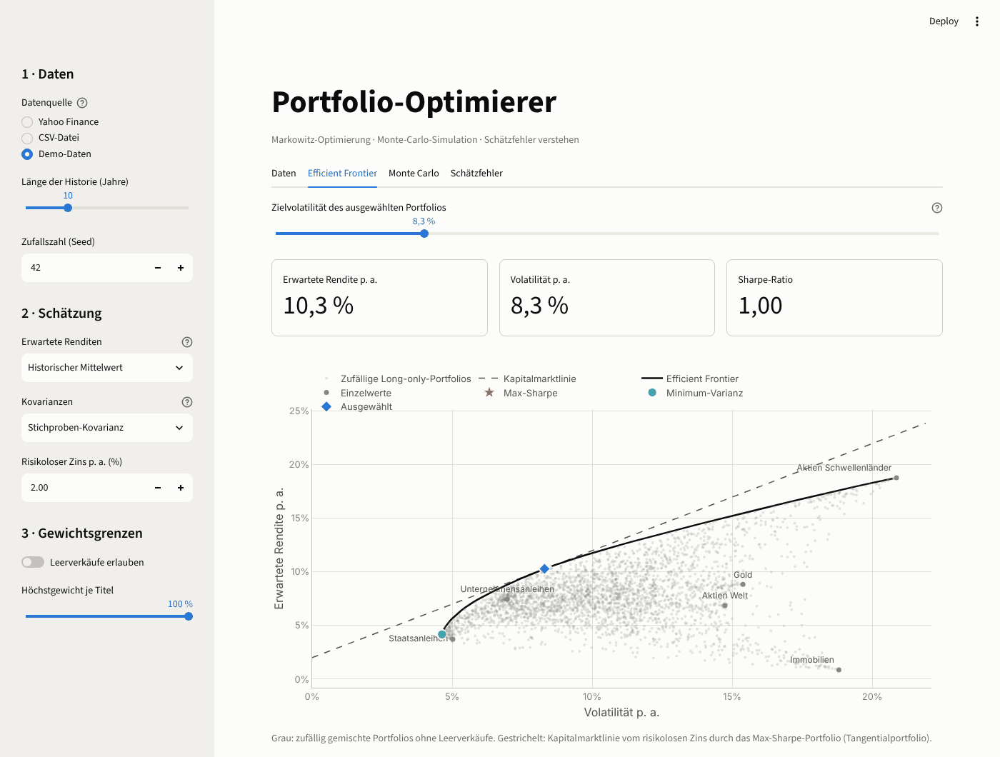
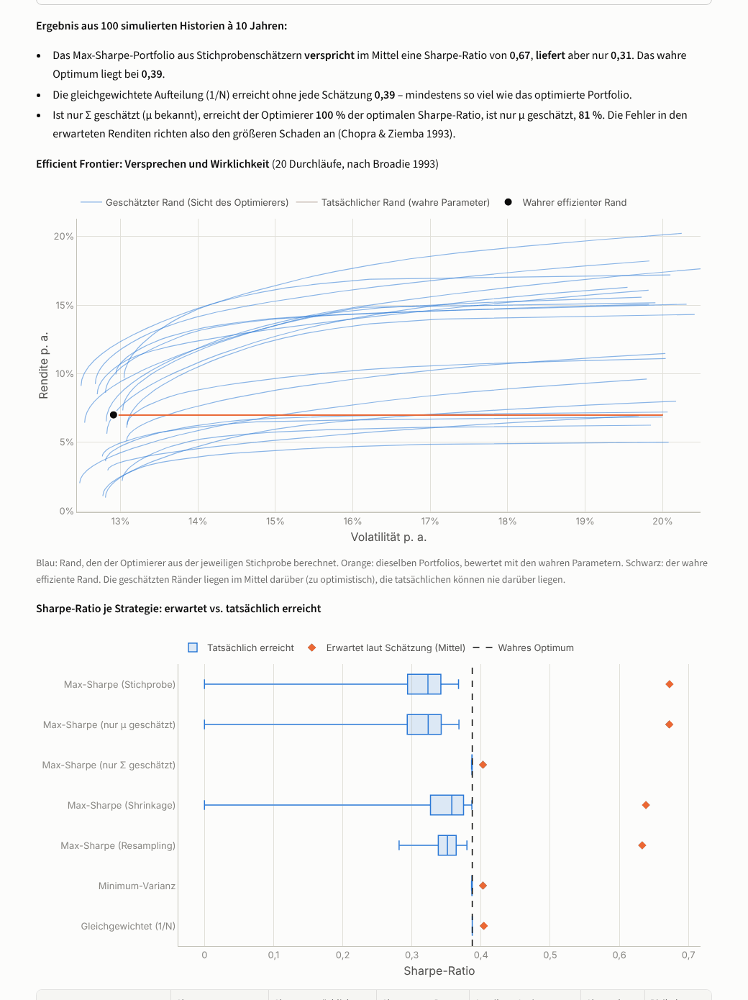

# Portfolio-Optimierer

Eine Streamlit-App für die Portfolio-Optimierung nach Markowitz: Aktien oder ETFs auswählen, historische Kurse laden, die **Efficient Frontier** berechnen und die Vermögensentwicklung per **Monte-Carlo-Simulation** durchspielen. Ein eigener Bereich zeigt, **warum die Optimierung mit geschätzten Parametern oft enttäuscht** und was dagegen hilft.



## Funktionen

| Tab | Inhalt |
|---|---|
| **Daten** | Wertentwicklung (Start = 100), Rendite, CAGR, Volatilität, Sharpe-Ratio und maximaler Drawdown je Asset, Korrelationsmatrix |
| **Efficient Frontier** | Effizienter Rand, Kapitalmarktlinie, Minimum-Varianz- und Max-Sharpe-Portfolio, frei wählbares Portfolio per Zielvolatilität, Gewichte entlang der Frontier, Risikobeiträge |
| **Monte Carlo** | Parametrische Simulation (korrelierte geometrische Brownsche Bewegung) oder historisches Block-Bootstrap, mit Sparrate, Fächerdiagramm, Verteilung des Endvermögens, Verlust- und Zielwahrscheinlichkeit, Drawdowns |
| **Schätzfehler** | Konfidenzintervalle der erwarteten Renditen, Sensitivität der Gewichte, Simulationsexperiment „versprochen vs. geliefert“, Vergleich mit Shrinkage, Resampling, Minimum-Varianz und 1/N |

In der Seitenleiste lassen sich Schätzer (historischer Mittelwert oder Bayes-Stein, Stichproben-Kovarianz oder Ledoit-Wolf), risikoloser Zins und Gewichtsgrenzen (long-only, Höchstgewichte, Leerverkäufe oder klassischer unbeschränkter Markowitz) einstellen.

## Schnellstart

```bash
python -m venv .venv
source .venv/bin/activate          # Windows: .venv\Scripts\activate
pip install -r requirements.txt
streamlit run app.py
```

Die App öffnet sich unter <http://localhost:8501>.

### Datenquellen

- **Yahoo Finance:** Ticker wie bei Yahoo, durch Komma getrennt, z. B. `AAPL, MSFT` oder für Xetra `SAP.DE, EUNL.DE`. Verwendet werden dividendenbereinigte Schlusskurse über [yfinance](https://github.com/ranaroussi/yfinance). Das ist eine inoffizielle Schnittstelle, für die die Nutzungsbedingungen von Yahoo gelten. Vorlagen für US-ETFs, Xetra-ETFs, DAX- und US-Aktien sind hinterlegt.
- **CSV-Datei:** Die erste Spalte enthält das Datum, danach folgt eine Spalte je Asset mit Kursen. Komma, Semikolon, Tabulator sowie deutsches Zahlen- und Datumsformat werden erkannt:
  ```
  Datum;Welt-ETF;Anleihen-ETF
  02.01.2024;101,20;55,10
  03.01.2024;102,05;54,80
  ```
- **Demo-Daten:** Simulierte Kurse sechs fiktiver Assetklassen. Damit lässt sich die App ohne Internetverbindung ausprobieren.

Assets mit unterschiedlichen Handelskalendern werden über kurze Lücken (bis zu fünf Tage) fortgeschrieben, anschließend wird auf den gemeinsamen Zeitraum zugeschnitten. Kurse bleiben in ihrer Handelswährung; Wechselkurse werden nicht umgerechnet.

## Methodik

**Schätzung.** Grundlage sind einfache Tagesrenditen. Erwartete Renditen und Kovarianzen werden mit 252 Handelstagen annualisiert.

- *Bayes-Stein (Jorion 1986):* zieht die Mittelwerte in Richtung der Rendite des Minimum-Varianz-Portfolios.
- *Ledoit-Wolf (2004):* Shrinkage der Kovarianzmatrix zum Modell konstanter Korrelation. Die Varianzen bleiben dabei erhalten.

**Optimierung.** Für jede Zielrendite $r^*$ wird

$$\min_w \; w^\top \Sigma w \quad \text{u. d. N.} \quad w^\top\mu = r^*,\quad \mathbf 1^\top w = 1,\quad l \le w_i \le u$$

gelöst, mit Gewichtsgrenzen numerisch (SLSQP) und ohne Grenzen in geschlossener Form. Das Max-Sharpe-Portfolio wird über das konvexe Ersatzproblem $\min_y y^\top\Sigma y$ unter $(\mu - r_f)^\top y = 1$ mit $w = y/\mathbf 1^\top y$ bestimmt. Weil dieses Problem konvex ist, gibt es keine lokalen Nebenoptima.

**Monte Carlo.** Die parametrische Variante simuliert monatliche Log-Renditen $\mathcal N\big((\mu - \tfrac12\operatorname{diag}\Sigma)\,\Delta t,\; \Sigma\,\Delta t\big)$. Das Bootstrap zieht zusammenhängende Blöcke von 21 historischen Handelstagen, wodurch Fat Tails und kurzfristige Abhängigkeiten erhalten bleiben. Das Portfolio wird monatlich auf die Zielgewichte zurückgesetzt; die Sparrate wird am Monatsende eingezahlt.

**Schätzfehler-Experiment.** Ein bekanntes „wahres“ Modell (die aktuellen Schätzungen oder N identische Assets) erzeugt viele alternative Kurshistorien. Auf jeder Historie wird geschätzt und optimiert, das Ergebnis wird anschließend mit den wahren Parametern bewertet. Verglichen werden:

- Max-Sharpe mit Stichprobenschätzern,
- Max-Sharpe mit nur geschätztem μ bzw. nur geschätztem Σ (Chopra & Ziemba 1993),
- Max-Sharpe mit Shrinkage (Bayes-Stein und Ledoit-Wolf),
- Resampled Efficiency nach Michaud (Mittel der Max-Sharpe-Gewichte über Parameterziehungen),
- Minimum-Varianz und 1/N.

Sieht eine Schätzung kein Portfolio über dem risikolosen Zins, bleibt der Anleger risikolos investiert (Sharpe-Ratio 0).



Im Szenario mit identischen Assets ist das wahre Optimum 1/N. Trotzdem verspricht der Optimierer im Mittel eine Sharpe-Ratio von 0,67 und liefert nur 0,31 – weniger als die schlichte Gleichgewichtung mit 0,39.

## Projektstruktur

```
app.py                         Streamlit-Oberfläche
portfolio_optimizer/
  data.py                      Yahoo Finance, CSV-Import, Datenbereinigung, Demo-Daten
  estimators.py                Mittelwert- und Kovarianzschätzer (Stichprobe, Bayes-Stein, Ledoit-Wolf)
  optimization.py              Minimum-Varianz, Max-Sharpe, Efficient Frontier, Zielrendite/-volatilität
  monte_carlo.py               GBM-Simulation und Block-Bootstrap
  instability.py               Schätzunsicherheit, Sensitivität, Simulationsexperimente
  charts.py                    Plotly-Diagramme (helles und dunkles Theme)
  formatting.py                Deutsche Zahlenformate
tests/                         pytest-Suite, inkl. Rauchtests der Oberfläche
```

## Tests

```bash
pip install -r requirements-dev.txt
pytest
```

Die Tests prüfen unter anderem die Optimierer gegen geschlossene Lösungen, den Ledoit-Wolf-Schätzer gegen eine direkte Umsetzung der Formeln aus dem Paper, die Monte-Carlo-Simulation gegen analytische Erwartungswerte und alle Tabs der Oberfläche mit `streamlit.testing`. Netzwerkzugriffe werden in den Tests durch Attrappen ersetzt.

## Grenzen

- Keine Anlageberatung. Die App ist ein Lern- und Analysewerkzeug.
- Transaktionskosten, Steuern und Wechselkurse werden nicht berücksichtigt.
- Die parametrische Simulation unterstellt normalverteilte Log-Renditen und behandelt die geschätzten Parameter als bekannt. Wie problematisch das ist, zeigt der Tab „Schätzfehler“.

## Literatur

- Markowitz, H. (1952): Portfolio Selection. *Journal of Finance* 7(1).
- Michaud, R. O. (1989): The Markowitz Optimization Enigma: Is 'Optimized' Optimal? *Financial Analysts Journal* 45(1).
- Best, M. J. & Grauer, R. R. (1991): On the Sensitivity of Mean-Variance-Efficient Portfolios to Changes in Asset Means. *Review of Financial Studies* 4(2).
- Broadie, M. (1993): Computing Efficient Frontiers Using Estimated Parameters. *Annals of Operations Research* 45.
- Chopra, V. K. & Ziemba, W. T. (1993): The Effect of Errors in Means, Variances, and Covariances on Optimal Portfolio Choice. *Journal of Portfolio Management* 19(2).
- Jorion, P. (1986): Bayes-Stein Estimation for Portfolio Analysis. *Journal of Financial and Quantitative Analysis* 21(3).
- Ledoit, O. & Wolf, M. (2004): Honey, I Shrunk the Sample Covariance Matrix. *Journal of Portfolio Management* 30(4).
- Jagannathan, R. & Ma, T. (2003): Risk Reduction in Large Portfolios: Why Imposing the Wrong Constraints Helps. *Journal of Finance* 58(4).
- DeMiguel, V., Garlappi, L. & Uppal, R. (2009): Optimal Versus Naive Diversification: How Inefficient Is the 1/N Portfolio Strategy? *Review of Financial Studies* 22(5).
